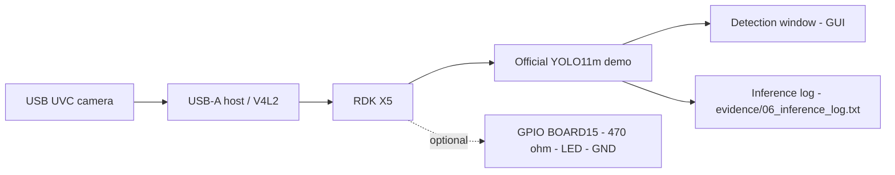

# EdgeVision

- **Participant:** Ashraf Al-Madhoun
- **Stage completed:** 1
- **Repository:** https://github.com/engasm89/RDK-X5-EdgeVision-Ignite-2026
- **Demo video:** TO_FILL — Stage 1 does not require a video; no demo video exists yet. Do not invent a link.
- **Community post:** TO_FILL — no Discord Stage 1 permalink exists yet. Do not invent a link.
- **License:** TO_FILL — verify before submitting: GitHub currently detects this repository's license as "Other (NOASSERTION)" despite the MIT LICENSE file (the appended third-party exclusion line likely breaks detection).

## Summary

EdgeVision is a reproducible, teaching-oriented Stage 1 entry for the Robotics Dream Keeper Challenge Winter 2026 that takes a D-Robotics RDK X5 from first boot to a visible on-device AI workload. The project targets students and makers who need a trustworthy, step-by-step path: flash a supported RDK X5 image, connect over SSH, validate a USB UVC camera as the sensor, and run D-Robotics' official YOLO11m object-detection demo on the board itself, with an optional GPIO LED heartbeat as a separate interface exercise. Everything is packaged in a public repository with bring-up, camera, model-setup, and verification scripts, wiring diagrams, and troubleshooting notes, so another participant can repeat the same run. The work so far is software preparation only: the scripts pass host-only mocked tests and the vendor demo archive URL is verified live, but no flash, camera frame, or inference run has yet been performed on physical hardware, so no performance figure is claimed. The next step is a genuine board run producing flash/SSH, camera, and YOLO evidence, a Discord Stage 1 post, and this showcase submission. (177 words)

## Technical Highlights

- **RDK board / image:** TO_FILL — board model and system-image name/version unknown; owner holds an Ambassador-program RDK X5 confirmed eligible by the organizer (4 Nov 2026), operational state unverified.
- **AI model and runtime:** Official D-Robotics YOLO11m demo (`yolo11m_demo.tar.gz`, downloaded on the board by `scripts/03_setup_model.sh`; archive URL verified live, 18,581,187 bytes, 6 Aug 2026). Exact `main.py --camera-id` invocation to be confirmed against the vendor README on the board.
- **Sensors and actuators:** USB UVC camera via USB-A host (V4L2, `/dev/video*`); camera make/model/VID:PID TO_FILL. Optional: red LED + 470 ohm resistor on GPIO BOARD15, GND BOARD14 (heartbeat only, not detection-driven).
- **ROS 2 design:** Not applicable to Stage 1. No ROS 2 nodes are used; ROS 2 design is planned for Stage 2.
- **BPU evidence and performance:** No BPU evidence and no performance figures exist yet. FPS, latency, power, and thermal values have NOT been measured; none are claimed.

## Architecture

The USB camera feeds frames to the RDK X5, where the official YOLO11m demo performs on-device detection and shows bounding boxes and labels in a GUI window; the run's terminal output is saved as an inference log. The optional LED circuit is an independent GPIO test and is not driven by detection results. Scripts: `01_preflight.sh` (diagnostics), `02_camera_test.py` (real frame capture), `03_setup_model.sh` (vendor demo download with tar validation), `04_run_yolo.sh` (board-identity guard + demo launch with log capture).

## Links and Evidence

- Stage evidence: TO_FILL — `evidence/01_flash_ssh.png`, `evidence/02_sensor_camera.png`, `evidence/03_yolo_on_rdk_x5.png`, `evidence/06_inference_log.txt` do not exist yet.
- Benchmarks: None — no benchmark has been run; no figures are claimed.
- Documentation: https://github.com/engasm89/RDK-X5-EdgeVision-Ignite-2026 (README, wiring diagrams, troubleshooting, `docs/TEST_REPORT.md`)

## Known Limitations and Safety

Software prepared and host-tested only; untested on the physical RDK X5. Board revision, OS image, and camera model are unknown. The board-identity guard regex in `04_run_yolo.sh` is unverified against a real `/proc/device-tree/model` string. The vendor archive has no pinned checksum. The YOLO demo requires an HDMI desktop or X11 forwarding. Camera capture assumes 640x480 and index 0. The LED is a heartbeat only; power off before wiring, verify board revision/IO voltage, never connect an LED without the 470 ohm resistor. Do not publish Wi-Fi passwords, tokens, private keys, or device serials in evidence. The AI-generated concept image in the repository (`assets/CONCEPT_ONLY_NOT_EVIDENCE.png`) is illustrative only and is not evidence.

---

CONSENT PENDING OWNER APPROVAL — do not submit until Ashraf explicitly approves. The official consent statement ("I agree that this showcase document may be used by the Robotics Dream Keeper Challenge organizers for program promotion, judging, and archives as described in the official README.") has NOT been agreed on the owner's behalf and must be added only after his explicit approval.
